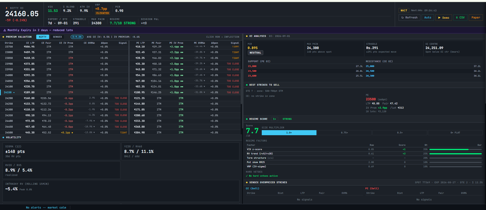

# Nifty & Sensex Options OI Dashboard

A real-time options analytics dashboard for Nifty and Sensex, built for option sellers. It pulls the live option chain from the Dhan API, analyses open interest and volatility, flags cheap and rich strikes, and runs a rule-based **paper-trading** engine so strategies can be tested without risking capital.


<sub>The dashboard running on live Nifty data.</sub>

> **Disclaimer:** Educational and research project, not financial advice. The Dhan API is used for market data only. The code never places real orders.

## Features

- **Live option chain and OI analysis**: OI build-up and unwinding, max pain, support and resistance, PCR, IV skew
- **Volatility engine**: Yang-Zhang and close-to-close realised vol, blended sigma, fair value and over-pricing (OVR%) for every strike, IV surface and skew history
- **Cheap / rich strike detection**: finds mispriced OTM strikes, plus a deep-OTM inflated-IV signal
- **PE/CE activity classifier**: separates fresh writing from covering and unwinding before an entry is allowed
- **Spike detector**: flags sudden index moves and pauses stop-losses accordingly
- **Greeks**: Black-Scholes delta, gamma, theta and vega for open positions
- **Risk engine**: session score with VIX, gap, event and PCR vetoes
- **Paper-trading engine**: iron condors, gap spreads, strangles, deep-OTM spreads and a panic-drop bounce trade, with DTE-scaled targets, trailing stops and realistic costs (brokerage, STT, GST, stamp duty)
- **Backtester**: synthetic-IV backtest on historical spot data, with Excel export and tearsheet
- **Sensex support**: separate feed, volatility calibration and analysis
- **Demo mode**: runs end to end on generated data, so you can explore it outside market hours without a broker account

## Tech stack

Python 3.11, Flask, SQLite, NumPy, SciPy, Rich, openpyxl, Dhan API (`dhanhq`), vanilla JS / HTML

## Getting started

```bash
git clone <your-repo-url>
cd nifty-oi-dashboard
pip install -r requirements.txt

cp config.example.py config.py       # Windows: copy config.example.py config.py
```

Edit `config.py` and add your Dhan `CLIENT_ID` and `ACCESS_TOKEN` (generate the token in the Dhan app; it expires daily). `config.py` is git-ignored and must never be committed.

Run the web dashboard:

```bash
python server.py
```

Then open <http://127.0.0.1:5050>. Click **Demo** in the top bar to explore with generated data, no broker connection needed.

Run the terminal dashboard instead:

```bash
python main.py        # R = refresh now, Q = quit
```

### Keeping data up to date

```bash
python -m oi_dashboard.feeds.update_spot_data        # Nifty daily history -> data/spot_all.csv
python -m oi_dashboard.feeds.sensex_spot_history     # Sensex daily history -> data/sensex_spot_all.csv
python -m oi_dashboard.feeds.fetch_nse_bhavcopy --help
```

### Tests

```bash
pip install -r requirements-dev.txt
pytest
```

## Project layout

```
server.py                  Flask entry point
main.py                    Terminal (Rich) entry point
config.example.py          All tunable parameters; copy to config.py
web/dashboard.html         Single-page front end
data/                      Spot history and event calendar
oi_dashboard/
  core/                    shared state, constants, paths
  feeds/                   Dhan, Sensex and NSE data sources
  analytics/               OI, volatility, Greeks, IV surface, signal classifiers
  market/                  payload builder, market hours, demo data
  trading/                 entry rules, strategies, risk engine, accounting, backtester
  storage/                 SQLite and session persistence
  services/                background workers
  api/                     Flask blueprints
  terminal/                terminal UI
tests/
```

See [docs/architecture.md](docs/architecture.md) for how the pieces fit together.

## Security

Never commit `config.py`: it holds your broker credentials and is listed in `.gitignore`.
